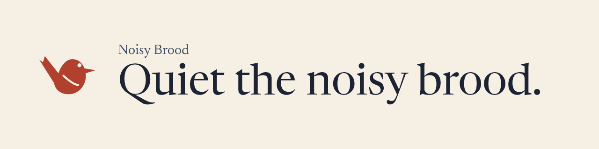
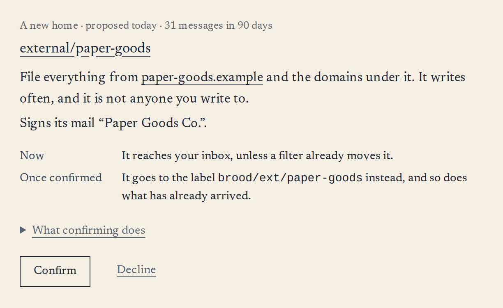

<!--
  This file renders on the Noisy Brood organization profile:
  https://github.com/Noisy-Brood

  The banner is drawn from the brand's tokens and the tagline, and the
  proposal is a picture of the app's own screen. Both are copies: redraw them
  when the mark, the palette or the screen changes.
-->

<picture>
  <source media="(prefers-color-scheme: dark)" srcset="banner-dark.png">
  
</picture>

Noisy Brood sorts a Gmail inbox by sender. Brood watches who writes to you and
proposes where their mail should live. It files nothing until you say so, and
it brings back the mail that matters: a reply in a conversation you wrote in, a
customer back after a silence, a password reset.

It is for an inbox that is part of the job, where somewhere among the customers,
candidates and counterparties is a message that can cost you a deal if you
miss it. It works with Gmail and Google Workspace, and it is not open to
everyone yet.

<picture>
  <source media="(prefers-color-scheme: dark)" srcset="proposal-dark.png">
  
</picture>

A proposal, as the app shows it, over invented mail.

### What Brood never reads

The subject line of any message, its body, its attachments, your drafts, or
anything in Drive, Calendar, Meet or Contacts, and nothing Brood reads is used
to train a model. [The full account](https://www.noisybrood.com/privacy/) says
what it does read and what it asks Google for.

The code that reads a mailbox is published in
[what-brood-reads](https://github.com/Noisy-Brood/what-brood-reads), copied
from the private repository whenever it changes, so the promise can be checked
rather than taken on trust.

### Read more

- [How it works](https://www.noisybrood.com/how-it-works/)
- [Pricing](https://www.noisybrood.com/pricing/)
- [Trust](https://www.noisybrood.com/trust/)
- [How Brood compares](https://www.noisybrood.com/compare/)
- [The blog](https://www.noisybrood.com/blog/), where it is being built in the open
- [Join the waitlist](https://www.noisybrood.com/waitlist/)

[noisybrood.com](https://www.noisybrood.com) · [hello@noisybrood.com](mailto:hello@noisybrood.com)
